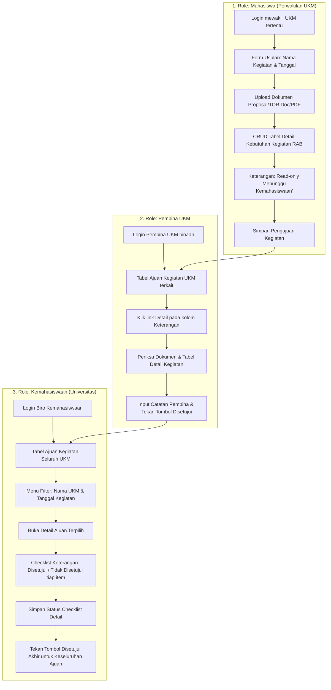

# Riwayat Pengembangan Projek: AjuanUKM (Project History)

Dokumen ini mencatat seluruh riwayat inisialisasi, rancangan arsitektur, implementasi alur kerja, pengujian, dan panduan operasional projek **AjuanUKM**.

---

## 1. Ringkasan Projek (Project Overview)

- **Nama Projek**: AjuanUKM
- **Deskripsi**: Sistem Informasi Pengajuan dan Verifikasi Kegiatan Mahasiswa berbasis Unit Kegiatan Mahasiswa (UKM) dengan persetujuan berjenjang.
- **Framework**: Laravel 10 (`laravel/framework: ^10.10`)
- **Bahasa Pemrograman**: PHP 8.4.20
- **Database**: MySQL 8.4.9 (`ajuan_ukm`)
- **Frontend Stack**: Blade Template Engine, Tailwind CSS, Alpine.js, Vite
- **Environment**: ServBay Local Web Server (`c:\Applications\ServBay\www\AjuanUKM`)
- **Waktu Inisialisasi**: 10 September 2026

---

## 2. Alur Kerja Sistem (Business Workflow)

Aplikasi mengimplementasikan 3 peran pengguna (*Role-Based Access Control*):



---

## 3. Tahapan & Riwayat Implementasi (Milestones)

### Fase 1: Riset Environment & Database Setup
- Memeriksa ketersediaan tool lokal ServBay: PHP 8.4, Composer 2.9, Node.js 23.11, MySQL 8.4.
- Membuat database MySQL `ajuan_ukm` dengan kredensial ServBay (`root:root`, host `127.0.0.1:3306`).
- Konfigurasi file `.env` dengan nama aplikasi `AjuanUKM` dan koneksi database MySQL.

### Fase 2: Inisialisasi Laravel 10 & Frontend Scaffolding
- Membuat skeleton project Laravel 10 menggunakan Composer.
- Memasang Laravel Breeze untuk modul autentikasi Blade.
- Memasang dependensi Node (`tailwindcss`, `@tailwindcss/forms`, `alpinejs`, `vite`).
- Menjalankan `php artisan storage:link` untuk akses publik file proposal di `storage/app/public`.

### Fase 3: Perancangan Skema Database (Database Migrations)
Dibuat 4 berkas migrasi:
1. `2024_09_10_070001_create_ukms_table.php`:
   - Menyimpan data master UKM (`nama_ukm`, `kode`, `kategori`, `deskripsi`, `pembina_nama`).
2. `2024_09_10_070002_add_role_and_ukm_id_to_users_table.php`:
   - Menambahkan kolom `role` (`mahasiswa`, `pembina`, `kemahasiswaan`), `ukm_id` (foreign key ke `ukms`), `nim_nip`, `no_hp`.
3. `2024_09_10_070003_create_ajuan_kegiatans_table.php`:
   - Header pengajuan kegiatan: `user_id`, `ukm_id`, `nama_kegiatan`, `tanggal_kegiatan`, `dokumen_proposal`, `dokumen_nama_asli`, `total_anggaran`, `status_pembina`, `catatan_pembina`, `verified_pembina_at`, `status_kemahasiswaan`, `catatan_kemahasiswaan`, `verified_kemahasiswaan_at`, `status_akhir`.
4. `2024_09_10_070004_create_detail_kegiatans_table.php`:
   - Rincian kebutuhan anggaran (RAB): `ajuan_kegiatan_id`, `no_urut`, `nama_akun`, `nama_barang`, `harga_satuan`, `jumlah`, `total`, `status_keterangan` (`belum_diverifikasi`, `disetujui`, `tidak_disetujui`), `catatan`.

### Fase 4: Eloquent Models & Relasi
- `App\Models\Ukm`: Relasi `hasMany` ke `User` dan `AjuanKegiatan`.
- `App\Models\User`: Relasi `belongsTo` ke `Ukm`, `hasMany` ke `AjuanKegiatan`, helper role `isMahasiswa()`, `isPembina()`, `isKemahasiswaan()`.
- `App\Models\AjuanKegiatan`: Relasi `belongsTo` ke `User`, `Ukm`, `pembinaVerifier`, `kemahasiswaanVerifier`, dan `hasMany` ke `DetailKegiatan`.
- `App\Models\DetailKegiatan`: Relasi `belongsTo` ke `AjuanKegiatan`.

### Fase 5: Middleware & Kontrol Akses Berbasis Peran
- Dibuat middleware `App\Http\Middleware\EnsureUserHasRole` (`role:mahasiswa,pembina,kemahasiswaan`).
- Didaftarkan alias `'role'` pada `app/Http/Kernel.php`.
- Dibuat `DashboardController` untuk mengarahkan pengguna secara dinamis ke dashboard perannya masing-masing saat login.

### Fase 6: Controllers & Tampilan UI (Blade + Tailwind + Alpine.js)
1. **Mahasiswa**:
   - `MahasiswaController`: method `index`, `create`, `store`, `show`, `downloadDokumen`.
   - `resources/views/mahasiswa/index.blade.php`: Tabel riwayat ajuan UKM miliknya dengan status Pembina & Kemahasiswaan.
   - `resources/views/mahasiswa/create.blade.php`: Form pengajuan + upload dokumen proposal (.pdf/.doc/.docx) + Alpine.js dynamic CRUD table dengan live subtotal/grand total dan status Keterangan read-only.
   - `resources/views/mahasiswa/show.blade.php`: Halaman detail pengajuan, timeline verifikasi, dan tabel detail item RAB.
2. **Pembina**:
   - `PembinaController`: method `index`, `show`, `verify`, `downloadDokumen`.
   - `resources/views/pembina/index.blade.php`: Tabel ajuan khusus UKM yang dibina dengan kolom Nama Kegiatan, Tanggal, Total Ajuan, Keterangan (berisi link detail), Catatan, Aksi.
   - `resources/views/pembina/show.blade.php`: Tampilan detail usulan + tabel detail kebutuhan + form catatan dan tombol persetujuan *"✓ Disetujui"*.
3. **Kemahasiswaan**:
   - `KemahasiswaanController`: method `index`, `show`, `updateDetailItems`, `approveOverall`, `downloadDokumen`.
   - `resources/views/kemahasiswaan/index.blade.php`: Tabel seluruh ajuan UKM lengkap dengan menu filter Nama UKM, Tanggal Kegiatan, Pencarian, kolom Verifikasi Pembina, Keterangan, Catatan, dan tombol Detail.
   - `resources/views/kemahasiswaan/show.blade.php`: Pemeriksaan tabel detail item dengan checklist radio *"✓ Disetujui"* / *"✗ Tdk Disetujui"* per baris item, tombol *"Centang Semua Disetujui"*, serta tombol utama *"✓ Disetujui (Setujui Seluruh Usulan Kegiatan)"*.
4. **Halaman Login Interaktif**:
   - `resources/views/auth/login.blade.php`: Dilengkapi panel pemilih akun cepat (1-Click Quick Demo Login Switcher).

### Fase 7: Seeder & Data Simulasi Realistis
- Dibuat `database/seeders/AjuanUKMSeeder.php`:
  - 4 Data Master UKM (Robotika, Seni Musik, Bola Basket, MAPALA).
  - 7 Akun Pengguna (Mahasiswa, Pembina, Kemahasiswaan).
  - File dummy PDF proposal di storage publik (`dokumen_proposal/sample_proposal.pdf`).
  - 3 Sampel Ajuan Kegiatan dalam tahapan status berbeda:
    1. *Workshop IoT & Robotika* (UKM Robotika): Menunggu Verifikasi Pembina.
    2. *Festival Musik Akustik* (UKM Seni Musik): Telah Disetujui Pembina, Siap Diverifikasi Kemahasiswaan.
    3. *Piala Rektor Basket 3x3* (UKM Basket): Telah Disetujui Keseluruhan.

### Fase 8: Pengujian & Validasi Awal
- Dibuat automated feature test `tests/Feature/AjuanUKMWorkflowTest.php` yang memvalidasi:
  1. Mahasiswa berhasil input pengajuan & CRUD detail kebutuhan.
  2. Pembina berhasil memeriksa dan menyetujui ajuan UKM binaannya.
  3. Kemahasiswaan berhasil memfilter UKM/tanggal, mencentang checklist detail item, dan menyetujui ajuan secara keseluruhan.
- Hasil pengujian: **28 tes lulus 100% (91 assertions)**.

### Fase 9: Penyempurnaan Prosedur - Alur Revisi Usulan (Feedback & Resubmission Loop)
- Menambahkan opsi **"⚠️ Minta Revisi"** pada panel verifikasi Pembina (`revisi_pembina`) dan Kemahasiswaan (`revisi_kemahasiswaan`) dengan catatan revisi wajib diisi.
- Menambahkan form interaktif `mahasiswa.edit` (`mahasiswa/edit.blade.php`) bagi mahasiswa untuk:
  - Melihat catatan revisi dari verifikator.
  - Memperbarui data kegiatan & mengganti proposal jika diperlukan.
  - Memodifikasi, menambah, atau membuang baris item kebutuhan kegiatan pada tabel RAB.
  - Menghitung ulang total anggaran secara real-time dan melacak `revisi_count`.
- Tombol **"Kirim Ulang Usulan (Resubmit)"**:
  - Jika revisi dari Pembina $\rightarrow$ status dikembalikan ke `menunggu_pembina`.
  - Jika revisi dari Kemahasiswaan $\rightarrow$ status langsung kembali ke `menunggu_kemahasiswaan`.
- Menambahkan 2 skenario uji end-to-end baru di `AjuanUKMWorkflowTest.php`:
  - `test_pembina_can_request_revision_and_student_can_resubmit()` [PASS]
  - `test_kemahasiswaan_can_request_revision_and_student_can_resubmit()` [PASS]
- Total pengujian meningkat menjadi: **30 tes lulus 100% (114 assertions)**.

### Fase 10: Penyempurnaan Prosedur - Modul Cetak Lembar Pengesahan PDF (Fitur No. 3)
- Memasang paket `barryvdh/laravel-dompdf:^3.1` untuk pembuatan dokumen PDF berstandar A4 portrait.
- Menerbitkan file konfigurasi `config/dompdf.php`.
- Membuat Controller `App\Http\Controllers\PengesahanPdfController`:
  - Mengatur otorisasi akses berjenjang (Mahasiswa & Pembina hanya dapat mengakses dokumen milik UKM-nya, Kemahasiswaan dapat mengakses seluruh UKM).
  - Format penomoran disposisi otomatis: `DISP/{KODE_UKM}/{TAHUN}/{ID_4DIGIT}`.
  - Perhitungan akumulasi anggaran yang disetujui secara otomatis.
  - Menghasilkan respon preview interaktif (*stream*) di tab browser atau unduh langsung (*download attachment*) dengan nama file `Lembar_Pengesahan_{NAMA_UKM}_{ID}.pdf`.
- Mendesain template cetak resmi `resources/views/pdf/lembar_pengesahan.blade.php`:
  1. Kop surat dinas universitas lengkap dengan logo dan garis ganda tebal-tipis.
  2. Judul dokumen resmi dan badge status keabsahan dokumen usulan kegiatan.
  3. Tabel identitas usulan kegiatan lengkap dengan pelacak revisi (`revisi_count`).
  4. Tabel Rincian Anggaran Biaya (RAB) terverifikasi dengan subtotal dan total biaya yang disetujui.
  5. Kotak catatan & rekomendasi verifikator (Pembina & Kemahasiswaan).
  6. Lembar pengesahan tanda tangan ganda berdampingan (Dosen Pembina UKM & Kepala Biro Kemahasiswaan) dilengkapi stempel/token keabsahan digital.
  7. Footer keabsahan sistem dan metadata cetak digital.
- Menambahkan tombol aksi **"🖨️ Cetak Pengesahan (PDF)"** pada:
  - Header halaman rincian Mahasiswa (`mahasiswa.show`), Pembina (`pembina.show`), dan Kemahasiswaan (`kemahasiswaan.show`).
  - Kolom aksi tabel daftar usulan Mahasiswa (`mahasiswa.index`), Pembina (`pembina.index`), dan Kemahasiswaan (`kemahasiswaan.index`).
- Mendaftarkan rute cetak pada `routes/web.php`:
  - `mahasiswa.cetak-pengesahan`
  - `pembina.cetak-pengesahan`
  - `kemahasiswaan.cetak-pengesahan`
- Menambahkan 2 automated feature test di `tests/Feature/AjuanUKMWorkflowTest.php`:
  - `test_authorized_users_can_generate_lembar_pengesahan_pdf()` [PASS]
  - `test_unauthorized_user_cannot_access_other_ukm_pdf()` [PASS]
- Total pengujian meningkat menjadi: **32 tes lulus 100% (125 assertions)**.

### Fase 11: Penyempurnaan Alur Perbaikan untuk Usulan Ditolak (Rejection Recovery & Resubmission)
- **Masalah**: Ketika usulan kegiatan ditolak (`status_akhir === 'ditolak'`) oleh Pembina maupun Kemahasiswaan disertai catatan alasan penolakan, helper `isPerluRevisi()` sebelumnya hanya mengecek status `revisi_pembina` dan `revisi_kemahasiswaan`, sehingga tombol **"Perbaiki Usulan (Revisi)"** dan banner instruksi perbaikan tidak muncul di antarmuka Mahasiswa.
- **Solusi & Perbaikan**:
  1. Memperbarui method `isPerluRevisi()`, `isRevisiPembina()`, dan `isRevisiKemahasiswaan()` pada `App\Models\AjuanKegiatan` untuk mendukung status `ditolak`, sehingga mahasiswa tetap dapat memperbaiki usulan kegiatan yang ditolak.
  2. Memperbarui `PembinaController::verify` dan `KemahasiswaanController::approveOverall` agar catatan penolakan selalu tersimpan ke kolom `catatan_revisi_terakhir`.
  3. Memperbarui tampilan `mahasiswa/show.blade.php`, `mahasiswa/index.blade.php`, dan `mahasiswa/edit.blade.php` dengan badge, banner instruksi, dan tombol aksi yang jelas: *"Perbaiki Usulan (Ditolak)"* / *"Alasan Penolakan & Arahan Perbaikan"*.
  4. Menambahkan test case `test_rejected_ajuan_can_be_revised_and_resubmitted_by_student()` di `AjuanUKMWorkflowTest.php`.
- Total pengujian meningkat menjadi: **33 tes lulus 100% (142 assertions)**.

### Fase 12: Menu Laporan, Statistik Realisasi Usulan per UKM & Ekspor Excel (.xlsx)
- Memasang paket `maatwebsite/excel:^3.1` yang terintegrasi dengan `phpoffice/phpspreadsheet`.
- Menerbitkan konfigurasi `config/excel.php`.
- Membuat Controller `App\Http\Controllers\LaporanKemahasiswaanController`:
  - `index`: Menghitung ringkasan KPI eksekutif universitas dan tabel rekapitulasi data agregasi seluruh UKM (total usulan, disetujui, dalam proses, ditolak, persentase realisasi, serapan dana disetujui).
  - `detail`: Menyajikan tampilan drill-down rincian kegiatan khusus untuk UKM tertentu.
  - `exportExcel`: Mengunduh file Excel multi-sheet (`.xlsx`) berstandar resmi.
- Membuat Export Class `App\Exports\LaporanRealisasiUkmExport`:
  - Sheet 1: *Rekapitulasi per UKM* (Data agregasi performa setiap UKM + baris total akumulasi universitas bergaya spreadsheet).
  - Sheet 2: *Rincian Seluruh Usulan* (Daftar terperinci seluruh ajuan kegiatan, tanggal, pengusul, status verifikasi pembina & kemahasiswaan, riwayat revisi, dan total anggaran).
- Merancang Blade Views:
  - `resources/views/kemahasiswaan/laporan/index.blade.php`: Dashboard KPI cards, toolbar filter/pencarian, tabel rekapitulasi realisasi per UKM dengan progress bar visual persentase, dan tombol drill-down.
  - `resources/views/kemahasiswaan/laporan/detail.blade.php`: Halaman rincian usulan UKM terpilih dengan metrik dan tabel daftar kegiatan.
- Menambahkan tautan menu **"Laporan & Statistik UKM"** di navigasi desktop & responsive mobile ([`navigation.blade.php`](file:///c:/Applications/ServBay/www/AjuanUKM/resources/views/layouts/navigation.blade.php)).
- Mendaftarkan rute `kemahasiswaan.laporan`, `kemahasiswaan.laporan.detail`, dan `kemahasiswaan.laporan.export` pada `routes/web.php`.
- Menambahkan 3 automated feature test di `tests/Feature/AjuanUKMWorkflowTest.php`:
  - `test_kemahasiswaan_can_access_laporan_dashboard_and_detail()` [PASS]
  - `test_kemahasiswaan_can_export_laporan_excel()` [PASS]
  - `test_unauthorized_users_cannot_access_laporan()` [PASS]
- Total pengujian meningkat menjadi: **36 tes lulus 100% (155 assertions)**.

### Fase 13: Manajemen Master Data UKM & Manajemen Pengguna (User Management)
- Membuat Controller `App\Http\Controllers\MasterUkmController`:
  - `index`: Daftar seluruh UKM dengan filter pencarian dan kategori, serta ringkasan metrik organisasi.
  - `create` & `store`: Penambahan UKM baru dengan kode unik uppercase, kategori, deskripsi, dan penugasan Dosen Pembina (pilih akun pembina terdaftar atau input manual).
  - `show`: Profil detail kelembagaan UKM, daftar dosen pembina terdaftar, daftar akun mahasiswa terdaftar, serta riwayat usulan kegiatan lengkap.
  - `edit` & `update`: Pembaruan profil UKM dan sinkronisasi penugasan pembina.
  - `destroy`: Penghapusan UKM dengan proteksi integritas data (mencegah penghapusan UKM yang telah memiliki riwayat usulan kegiatan).
- Membuat Controller `App\Http\Controllers\MasterUserController`:
  - `index`: Daftar pengguna sistem dengan filter peran (Mahasiswa, Pembina, Kemahasiswaan), filter UKM, pencarian teks, dan ringkasan metrik.
  - `create` & `store`: Pembuatan akun baru dengan validasi kata sandi, pemilihan peran, dan dropdown dinamis UKM.
  - `edit` & `update`: Pembaruan profil pengguna, hak akses, UKM, serta fasilitas opsional ubah/reset kata sandi baru.
  - `destroy`: Penghapusan akun pengguna dengan proteksi keamanan (mencegah penghapusan akun diri sendiri yang sedang aktif dan mencegah penghapusan akun mahasiswa yang memiliki riwayat usulan kegiatan).
- Merancang Blade Views:
  - `resources/views/kemahasiswaan/ukm/index.blade.php`: Tabel master UKM, filter, badge kategori & pembina, serta tombol aksi.
  - `resources/views/kemahasiswaan/ukm/create.blade.php`: Form penambahan UKM baru.
  - `resources/views/kemahasiswaan/ukm/edit.blade.php`: Form edit data UKM.
  - `resources/views/kemahasiswaan/ukm/show.blade.php`: Halaman profil UKM, anggota, dan riwayat kegiatan.
  - `resources/views/kemahasiswaan/users/index.blade.php`: Tabel pengguna, filter peran & UKM, serta tombol aksi.
  - `resources/views/kemahasiswaan/users/create.blade.php`: Form registrasi pengguna baru dengan toggle dinamis.
  - `resources/views/kemahasiswaan/users/edit.blade.php`: Form edit data pengguna dan reset password.
- Menambahkan tautan menu **"Master UKM"** dan **"Data Pengguna"** di bilah navigasi utama Kemahasiswaan ([`navigation.blade.php`](file:///c:/Applications/ServBay/www/AjuanUKM/resources/views/layouts/navigation.blade.php)).
- Mendaftarkan rute resource `kemahasiswaan.ukm.*` dan `kemahasiswaan.users.*` pada `routes/web.php` dengan middleware `role:kemahasiswaan`.
- Menambahkan 3 skenario test komprehensif di `tests/Feature/AjuanUKMWorkflowTest.php`:
  - `test_kemahasiswaan_can_crud_master_ukm()` [PASS]
  - `test_kemahasiswaan_can_crud_users_and_safety_checks()` [PASS]
  - `test_unauthorized_users_cannot_access_master_data()` [PASS]
- Total automated tests meningkat menjadi: **39 tes lulus 100% (197 assertions)**.

---

## 4. Daftar Akun Uji Coba (Credentials)

Semua akun menggunakan password standar: `password`

| Peran (Role) | Nama Akun | Email | UKM Terkait |
|---|---|---|---|
| **Kemahasiswaan** | Biro Kemahasiswaan & Alumni | `kemahasiswaan@univ.ac.id` | Seluruh UKM (Admin Universitas) |
| **Pembina** | Dr. Ir. Hendra Setiawan, M.T. | `pembina.robotika@univ.ac.id` | UKM Robotika & Otomasi |
| **Pembina** | Rina Wijayanti, M.Pd. | `pembina.musik@univ.ac.id` | UKM Seni Musik Kampus |
| **Pembina** | Bambang Sudibyo, M.Or. | `pembina.basket@univ.ac.id` | UKM Bola Basket Patriot |
| **Mahasiswa** | Ahmad Fauzi | `mahasiswa.robotika@univ.ac.id` | UKM Robotika & Otomasi |
| **Mahasiswa** | Putri Ayu | `mahasiswa.musik@univ.ac.id` | UKM Seni Musik Kampus |
| **Mahasiswa** | Dimas Arya | `mahasiswa.basket@univ.ac.id` | UKM Bola Basket Patriot |

---

## 5. Panduan Menjalankan & Perawatan Aplikasi

### Menjalankan Server Development
```powershell
cd c:\Applications\ServBay\www\AjuanUKM
php artisan serve
```
Buka browser di: `http://127.0.0.1:8000`

### Menjalankan Asset Vite (Development Mode)
```powershell
npm run dev
```

### Build Ulang Asset (Production Mode)
```powershell
npm run build
```

### Reset & Seed Ulang Database
```powershell
php artisan migrate:fresh --seed
```

### Menjalankan Seluruh Automated Test
```powershell
php artisan test
```

---

## 6. Struktur Direktori Utama

```
AjuanUKM/
├── app/
│   ├── Exports/
│   │   └── LaporanRealisasiUkmExport.php      # Multi-sheet Excel export (.xlsx)
│   ├── Http/
│   │   ├── Controllers/
│   │   │   ├── DashboardController.php        # Pengarah dashboard sesuai role
│   │   │   ├── MahasiswaController.php        # Flow usulan mahasiswa
│   │   │   ├── PembinaController.php          # Flow verifikasi pembina
│   │   │   ├── KemahasiswaanController.php    # Flow verifikasi kemahasiswaan & filter
│   │   │   ├── LaporanKemahasiswaanController.php # Laporan rekapitulasi UKM & statistik
│   │   │   └── PengesahanPdfController.php    # Export Lembar Pengesahan PDF (A4)
│   │   └── Middleware/
│   │       └── EnsureUserHasRole.php          # Otorisasi hak akses role
│   └── Models/
│       ├── Ukm.php                            # Model master UKM
│       ├── User.php                           # Model pengguna & relasi role
│       ├── AjuanKegiatan.php                  # Model header usulan kegiatan
│       └── DetailKegiatan.php                 # Model detail item anggaran (RAB)
├── database/
│   ├── migrations/                            # 4 migrasi custom untuk skema UKM & ajuan
│   └── seeders/
│       └── AjuanUKMSeeder.php                 # Seeder master UKM, user, & sampel ajuan
├── resources/
│   └── views/
│       ├── auth/login.blade.php               # Halaman login dengan 1-click quick switcher
│       ├── layouts/                           # Layouts app & navigasi berbasis role
│       ├── mahasiswa/                         # Views untuk mahasiswa (index, create, show)
│       ├── pembina/                           # Views untuk pembina (index, show)
│       ├── kemahasiswaan/                     # Views untuk kemahasiswaan (index, show, laporan/)
│       └── pdf/                               # Template dokumen resmi siap cetak
│           └── lembar_pengesahan.blade.php    # Template PDF Lembar Pengesahan & Disposisi
├── tests/Feature/
│   └── AjuanUKMWorkflowTest.php               # End-to-end automated workflow test
├── PROJECT_HISTORY.md                         # Dokumentasi riwayat projek ini
└── README.md
```
