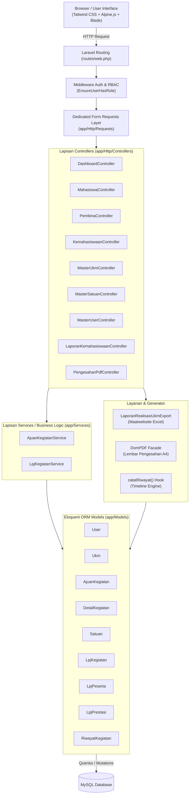
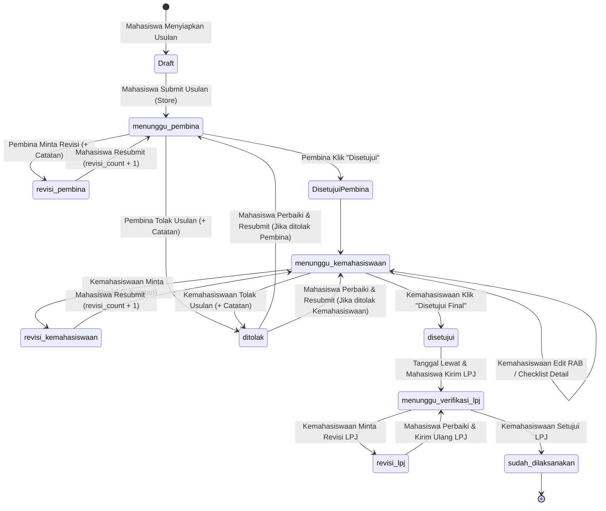

# Cetak Biru Sistem: AjuanUKM (System Map & Architecture Blueprint)

Dokumen ini merupakan cetak biru arsitektur komprehensif, pemetaan alur data, skema basis data, dan peta navigasi teknis dari aplikasi **AjuanUKM** untuk memandu pengembang serta agen otonom dalam memahami, memelihara, dan mengembangkan sistem lebih lanjut.

---

## 1. Ringkasan Eksekutif (System Overview)

| Informasi | Deskripsi |
|---|---|
| **Nama Aplikasi** | **AjuanUKM** (Sistem Informasi Pengajuan, Verifikasi Kegiatan & LPJ SIMKATMAWA) |
| **Tujuan Utama** | Digitalisasi pengajuan usulan kegiatan UKM, verifikasi berjenjang (Dosen Pembina & Biro Kemahasiswaan), penganggaran dinamis (RAB), penerbitan Lembar Pengesahan PDF resmi, serta pelaporan LPJ pasca-kegiatan terintegrasi pemeringkatan nasional **SIMKATMAWA** Kemendikbudristek. |
| **Framework & Versi** | **Laravel 10.x** (`laravel/framework: ^10.0`) |
| **Bahasa Pemrograman** | **PHP 8.4** (Kompatibel PHP >= 8.1) |
| **Basis Data** | **MySQL 8.4+** (`ajuan_ukm`) |
| **Frontend Stack** | Blade Templates, Tailwind CSS 3.x, Alpine.js 3.x, Vite |
| **Paket Utama** | `barryvdh/laravel-dompdf` (^3.1), `maatwebsite/excel` (^3.1), `laravel/breeze` (1.29), `laravel/sanctum` (^3.2) |
| **Status Uji Otomatis** | **67 Feature & Unit Tests Passed (100%)** – 429 assertions |

---

## 2. Arsitektur Sistem & Lapisan Komponen (High-Level Architecture)

Aplikasi dibangun dengan pola Model-View-Controller (MVC) standar Laravel yang diperkaya dengan integrasi *reactive front-end* ringan (Alpine.js) untuk interaksi tabel dinamis tanpa overhead framework SPA penuh.



---

## 3. Skema Basis Data & Relasi Entitas (Database ERD & Schema)

### 3.1 Entity Relationship Diagram (ERD)

```mermaid
erDiagram
    UKMS ||--o{ USERS : "memiliki anggota/pembina"
    UKMS ||--o{ AJUAN_KEGIATANS : "mengajukan kegiatan"
    USERS ||--o{ AJUAN_KEGIATANS : "pembuat usulan"
    USERS ||--o{ AJUAN_KEGIATANS : "diverifikasi oleh pembina"
    USERS ||--o{ AJUAN_KEGIATANS : "diverifikasi oleh kemahasiswaan"
    AJUAN_KEGIATANS ||--|{ DETAIL_KEGIATANS : "memiliki rincian RAB"
    AJUAN_KEGIATANS ||--o| LPJ_KEGIATANS : "memiliki laporan LPJ"
    AJUAN_KEGIATANS ||--o{ RIWAYAT_KEGIATANS : "merekam jejak aktivitas"
    USERS ||--o{ RIWAYAT_KEGIATANS : "pelaku aksi audit trail"
    LPJ_KEGIATANS ||--o{ LPJ_PESERTAS : "daftar kontingen SIMKATMAWA"
    LPJ_KEGIATANS ||--o{ LPJ_PRESTASIES : "daftar raihan juara"
    SATUANS ||..o{ DETAIL_KEGIATANS : "referensi satuan kebutuhan"

    UKMS {
        bigint id PK
        string nama_ukm
        string kode UK
        string kategori
        text deskripsi
        string pembina_nama
        timestamp created_at
        timestamp updated_at
    }

    USERS {
        bigint id PK
        string name
        string email UK
        string password
        enum role "mahasiswa, pembina, kemahasiswaan"
        bigint ukm_id FK "nullable"
        string nim_nip "nullable"
        string no_hp "nullable"
        timestamp created_at
        timestamp updated_at
    }

    AJUAN_KEGIATANS {
        bigint id PK
        bigint user_id FK
        bigint ukm_id FK
        string nama_kegiatan
        date tanggal_kegiatan
        string jenis_kegiatan "Lomba, Pelatihan, Lainnya"
        string dokumen_proposal
        string dokumen_nama_asli
        decimal total_anggaran "15,2"
        string status_pembina
        text catatan_pembina
        timestamp verified_pembina_at
        bigint verified_pembina_by FK
        string status_kemahasiswaan
        text catatan_kemahasiswaan
        timestamp verified_kemahasiswaan_at
        bigint verified_kemahasiswaan_by FK
        string status_akhir
        int revisi_count
        text catatan_revisi_terakhir
        timestamp created_at
        timestamp updated_at
    }

    DETAIL_KEGIATANS {
        bigint id PK
        bigint ajuan_kegiatan_id FK
        int no_urut
        string nama_akun
        string nama_barang
        decimal harga_satuan "15,2"
        int jumlah
        string satuan
        float durasi
        string satuan_durasi
        decimal total "15,2"
        enum status_keterangan "belum_diverifikasi, disetujui, tidak_disetujui"
        text catatan
        timestamp created_at
        timestamp updated_at
    }

    SATUANS {
        bigint id PK
        string nama_satuan UK
        string keterangan
        boolean is_aktif
        timestamp created_at
        timestamp updated_at
    }

    LPJ_KEGIATANS {
        bigint id PK
        bigint ajuan_kegiatan_id FK UK
        string prestasi
        int jumlah_peserta
        text ringkasan_kegiatan
        decimal realisasi_anggaran "15,2"
        string file_sertifikat
        string foto_kegiatan
        string foto_penyerahan
        string surat_undangan
        text catatan_verifikasi_lpj
        timestamp verified_lpj_at
        bigint verified_lpj_by FK
        timestamp submitted_at
        timestamp created_at
        timestamp updated_at
    }

    LPJ_PESERTAS {
        bigint id PK
        bigint lpj_kegiatan_id FK
        string nama
        string npm
        string peran
        timestamp created_at
        timestamp updated_at
    }

    LPJ_PRESTASIES {
        bigint id PK
        bigint lpj_kegiatan_id FK
        string kategori_lomba
        string peringkat_juara
        string tingkat
        string nama_peraih
        timestamp created_at
        timestamp updated_at
    }

    RIWAYAT_KEGIATANS {
        bigint id PK
        bigint ajuan_kegiatan_id FK
        bigint user_id FK
        string role
        string aksi
        string status_sebelumnya
        string status_sesudah
        text catatan
        timestamp created_at
        timestamp updated_at
    }
```

### 3.2 Detail Tabel & Integritas Data

1. **`ukms`**: Master organisasi UKM kampus. Memiliki proteksi integritas penghapusan (tidak dapat dihapus jika telah memiliki relasi riwayat usulan kegiatan).
2. **`users`**: Pengguna sistem dengan peran `mahasiswa`, `pembina`, atau `kemahasiswaan`. Kolom `ukm_id` diatur bernilai `NULL` untuk peran `kemahasiswaan`.
3. **`ajuan_kegiatans`**: Header usulan kegiatan. Mengaitkan relasi ke pengusul (`user_id`), UKM (`ukm_id`), serta pencatat verifikator (`verified_pembina_by`, `verified_kemahasiswaan_by`).
4. **`detail_kegiatans`**: Baris rincian anggaran (RAB). Menghitung `total = harga_satuan * jumlah * durasi`. Memiliki status persetujuan per-item (`disetujui`, `tidak_disetujui`, `belum_diverifikasi`).
5. **`satuans`**: Master satuan kebutuhan dinamis (contoh: *Buah, Orang, Hari, Paket, Unit*). Dilengkapi pengecekan pemakaian sebelum dihapus.
6. **`lpj_kegiatans`**: Entitas pelaporan pasca-pelaksanaan yang hanya diaktifkan jika usulan telah berstatus `disetujui` dan tanggal kegiatan telah lewat.
7. **`lpj_pesertas`**: Data pendataan peserta kontingen untuk keperluan pelaporan borang akreditasi SIMKATMAWA.
8. **`lpj_prestasies`**: Perekaman capaian juara/medali lebih dari satu (multi-prestasi) per ajang kompetisi.
9. **`riwayat_kegiatans`**: Tabel audit log kronologis yang mencatat setiap transisi status, perubahan anggaran RAB, permintaan revisi, penolakan, penyerahan LPJ, hingga persetujuan akhir.

---

## 4. Mesin Status & Alur Bisnis (State Machine & Workflow)

Sistem mengadopsi mesin status (*state machine*) ketat dengan siklus revisi dan pemulihan penolakan (*rejection recovery loop*):



### Keterangan Nilai `status_akhir`:
- `menunggu_pembina`: Usulan baru diajukan, menunggu telaah Dosen Pembina UKM.
- `revisi_pembina`: Dosen Pembina meminta perbaikan berkas/anggaran kepada mahasiswa.
- `menunggu_kemahasiswaan`: Telah disetujui Pembina, menunggu telaah & penyesuaian RAB oleh Biro Kemahasiswaan.
- `revisi_kemahasiswaan`: Biro Kemahasiswaan meminta perbaikan usulan.
- `ditolak`: Usulan ditolak oleh Pembina atau Kemahasiswaan (mahasiswa tetap diberikan akses untuk memperbaiki jika diizinkan).
- `disetujui`: Usulan disetujui penuh oleh Universitas; Lembar Pengesahan PDF resmi dapat dicetak.
- `menunggu_verifikasi_lpj`: Kegiatan telah disetujui, tanggal pelaksanaan terlewati, dan berkas LPJ telah dikirimkan mahasiswa.
- `revisi_lpj`: Kemahasiswaan mengembalikan LPJ untuk dilengkapi bukti/perbaikan.
- `sudah_dilaksanakan`: LPJ diverifikasi dan disetujui; seluruh siklus kegiatan tuntas.

---

## 5. Matriks Routing & Kontrol Akses (RBAC & Route Map)

Otorisasi dikendalikan oleh middleware `App\Http\Middleware\EnsureUserHasRole` (alias `'role'`).

| Metode | URI Endpoint | Nama Rute | Controller & Method | Middleware | Deskripsi Hak Akses |
|---|---|---|---|---|---|
| `GET` | `/` | - | Closure redirect | Guest / Public | Dialihkan ke halaman login |
| `GET` | `/dashboard` | `dashboard` | `DashboardController@index` | `auth` | Pengarah dinamis ke dashboard perannya |
| **Mahasiswa** | | | | `auth, role:mahasiswa` | |
| `GET` | `/mahasiswa/dashboard` | `mahasiswa.dashboard` | `MahasiswaController@index` | | Riwayat pengajuan UKM milik user |
| `GET` | `/mahasiswa/pengajuan/create` | `mahasiswa.create` | `MahasiswaController@create` | | Form usulan baru + dynamic RAB |
| `POST`| `/mahasiswa/pengajuan` | `mahasiswa.store` | `MahasiswaController@store` | | Simpan ajuan awal & file proposal |
| `GET` | `/mahasiswa/pengajuan/{id}` | `mahasiswa.show` | `MahasiswaController@show` | | Tampilan detail & status usulan |
| `GET` | `/mahasiswa/pengajuan/{id}/edit` | `mahasiswa.edit` | `MahasiswaController@edit` | | Form perbaikan/revisi data & RAB |
| `PUT` | `/mahasiswa/pengajuan/{id}` | `mahasiswa.update` | `MahasiswaController@update` | | Simpan revisi & resubmit alur |
| `GET` | `/mahasiswa/pengajuan/{id}/download` | `mahasiswa.download` | `MahasiswaController@downloadDokumen` | | Unduh dokumen proposal |
| `GET` | `/mahasiswa/pengajuan/{id}/cetak-pengesahan` | `mahasiswa.cetak-pengesahan` | `PengesahanPdfController@cetak` | | Cetak Lembar Pengesahan PDF (A4) |
| `GET` | `/mahasiswa/pengajuan/{id}/lpj` | `mahasiswa.lpj` | `MahasiswaController@lpjForm` | | Formulir pengisian LPJ kegiatan |
| `POST`| `/mahasiswa/pengajuan/{id}/lpj` | `mahasiswa.lpj.store` | `MahasiswaController@storeLpj` | | Simpan capaian, peserta & 4 berkas |
| `GET` | `/mahasiswa/pengajuan/{id}/lpj/download/{type}` | `mahasiswa.lpj.download` | `MahasiswaController@downloadLpjFile` | | Unduh berkas sertifikat/foto/undangan |
| **Pembina** | | | | `auth, role:pembina` | |
| `GET` | `/pembina/dashboard` | `pembina.dashboard` | `PembinaController@index` | | Daftar usulan UKM yang dibina |
| `GET` | `/pembina/pengajuan/{id}` | `pembina.show` | `PembinaController@show` | | Pemeriksaan proposal & rincian RAB |
| `POST`| `/pembina/pengajuan/{id}/verify` | `pembina.verify` | `PembinaController@verify` | | Aksi Disetujui / Minta Revisi / Tolak |
| `GET` | `/pembina/pengajuan/{id}/download` | `pembina.download` | `PembinaController@downloadDokumen` | | Unduh dokumen proposal binaannya |
| `GET` | `/pembina/pengajuan/{id}/cetak-pengesahan` | `pembina.cetak-pengesahan` | `PengesahanPdfController@cetak` | | Cetak Lembar Pengesahan PDF |
| `GET` | `/pembina/pengajuan/{id}/lpj/download/{type}` | `pembina.lpj.download` | `PembinaController@downloadLpjFile` | | Unduh berkas bukti LPJ binaannya |
| **Kemahasiswaan** | | | | `auth, role:kemahasiswaan` | |
| `GET` | `/kemahasiswaan/dashboard` | `kemahasiswaan.dashboard` | `KemahasiswaanController@index` | | Daftar usulan seluruh UKM + filter |
| `GET` | `/kemahasiswaan/pengajuan/{id}` | `kemahasiswaan.show` | `KemahasiswaanController@show` | | Verifikasi 2 Tab (RAB & Linimasa) |
| `POST`| `/kemahasiswaan/pengajuan/{id}/detail-items` | `kemahasiswaan.update-details`| `KemahasiswaanController@updateDetailItems`| | Checklist persetujuan & edit baris RAB |
| `POST`| `/kemahasiswaan/pengajuan/{id}/approve` | `kemahasiswaan.approve` | `KemahasiswaanController@approveOverall` | | Persetujuan final / Minta Revisi / Tolak |
| `POST`| `/kemahasiswaan/pengajuan/{id}/verify-lpj` | `kemahasiswaan.verify-lpj` | `KemahasiswaanController@verifyLpj` | | Verifikasi laporan LPJ (Setuju / Revisi) |
| `GET` | `/kemahasiswaan/pengajuan/{id}/download` | `kemahasiswaan.download` | `KemahasiswaanController@downloadDokumen` | | Unduh proposal kegiatan |
| `GET` | `/kemahasiswaan/pengajuan/{id}/cetak-pengesahan` | `kemahasiswaan.cetak-pengesahan`| `PengesahanPdfController@cetak` | | Cetak Lembar Pengesahan resmi |
| `GET` | `/kemahasiswaan/pengajuan/{id}/lpj/download/{type}` | `kemahasiswaan.lpj.download` | `KemahasiswaanController@downloadLpjFile` | | Unduh berkas dokumentasi LPJ |
| `GET` | `/kemahasiswaan/laporan` | `kemahasiswaan.laporan` | `LaporanKemahasiswaanController@index` | | Dashboard statistik & rekapitulasi realisasi |
| `GET` | `/kemahasiswaan/laporan/export-excel` | `kemahasiswaan.laporan.export` | `LaporanKemahasiswaanController@exportExcel` | | Ekspor rekapitulasi Excel multi-sheet |
| `GET` | `/kemahasiswaan/laporan/{ukm_id}` | `kemahasiswaan.laporan.detail`| `LaporanKemahasiswaanController@detail` | | Drill-down data kegiatan spesifik UKM |
| `RESOURCE`| `/kemahasiswaan/master-ukm` | `kemahasiswaan.ukm.*` | `MasterUkmController` | | CRUD Master UKM organisasi kampus |
| `RESOURCE`| `/kemahasiswaan/master-satuan`| `kemahasiswaan.satuan.*`| `MasterSatuanController` | | CRUD Master Satuan kebutuhan RAB |
| `RESOURCE`| `/kemahasiswaan/users` | `kemahasiswaan.users.*` | `MasterUserController` | | CRUD Manajemen Akun & Hak Akses |

---

## 6. Peta Modul Kunci (Key Modules & Subsystems)

### 6.1 Kalkulator RAB & Validasi Dinamis
- **Formula Subtotal**:
  $$\text{Subtotal Baris} = \text{Harga Satuan} \times \text{Jumlah} \times \text{Durasi}$$
- **Mode Edit Mahasiswa**: Dapat menambah, mengubah, atau membuang baris anggaran secara real-time via Alpine.js selama usulan belum disetujui (`status_akhir != 'disetujui'`).
- **Mode Verifikasi & Penyesuaian Kemahasiswaan**: Biro Kemahasiswaan memiliki wewenang untuk:
  - Mengubah harga, volume, atau durasi yang diajukan.
  - Memberikan checklist status per item (`disetujui` vs `tidak_disetujui`).
  - Menambah baris alokasi baru atau mencoret item yang tidak disetujui.
  - Menghitung ulang total anggaran otomatis saat disimpan.

### 6.2 Alur Revisi & Penolakan Berjenjang
- Verifikator (Pembina atau Kemahasiswaan) wajib memberikan alasan tertulis ketika memilih opsi **"⚠️ Minta Revisi"** atau **"❌ Ditolak"**.
- Catatan disimpan pada `catatan_revisi_terakhir` dan direkam ke riwayat aktivitas.
- Mahasiswa menerima instruksi perbaikan melalui alert kontekstual pada antarmuka usulan.
- Resubmit usulan otomatis meningkatkan `revisi_count` dan mengembalikan usulan ke antrean verifikator terkait.

### 6.3 Modul LPJ & Pemeringkatan SIMKATMAWA
- **Pencatatan Multi-Prestasi (`lpj_prestasies`)**: Mendukung perekaman banyak prestasi dalam satu ajang kejuaraan (misal: *Juara 1 Kumite Perorangan*, *Juara 2 Kata Beregu*). Lengkap dengan peringkat, tingkat kejuaraan (*Internal, Wilayah, Nasional, Internasional*), dan nama peraih.
- **Pendataan Kontingen SIMKATMAWA (`lpj_pesertas`)**: Perekaman Nama Lengkap, NIM/NPM, dan Peran kontingen (*Peserta, Official, Manajer*).
- **Perhitungan Realisasi vs Pagu**: Perbandingan otomatis antara alokasi anggaran yang disetujui dengan belanja riil mahasiswa untuk evaluasi efisiensi anggaran universitas.
- **Unggah Bukti Dokumentasi**: 4 slot berkas (*Sertifikat/Piagam, Foto Kegiatan, Foto Penyerahan Piala, dan Surat Undangan Resmi*).

### 6.4 Mesin Audit Trail & Linimasa Kronologis (`RiwayatKegiatan`)
- Setiap aksi mutasi memicu pemanggilan helper model:
  ```php
  $ajuan->catatRiwayat(
      aksi: 'Persetujuan Kemahasiswaan (Final)',
      statusSesudah: 'disetujui',
      catatan: 'Usulan telah disetujui secara keseluruhan.',
      statusSebelumnya: 'menunggu_kemahasiswaan',
      userId: Auth::id(),
      role: 'kemahasiswaan'
  );
  ```
- Komponen visual `<x-timeline-riwayat :riwayats="$ajuan->riwayats" />` merender linimasa vertikal dengan indikator status terkini, ikon badge, peran pelaku, tanggal-jam WIB, dan kutipan catatan.

### 6.5 Generator Lembar Pengesahan PDF (A4 Portrait)
- Dihasilkan via `PengesahanPdfController` menggunakan `barryvdh/laravel-dompdf`.
- Standar penomoran resmi: `DISP/{KODE_UKM}/{TAHUN}/{ID_4DIGIT}`.
- Komponen dokumen meliputi kop surat dinas universitas, tabel rincian kegiatan, tabel RAB yang disetujui, catatan verifikator, dan tanda tangan ganda Dosen Pembina & Kepala Biro Kemahasiswaan dilengkapi token keabsahan digital.

### 6.6 Dashboard Laporan & Ekspor Excel Multi-Sheet
- Menampilkan KPI Agregasi: Total Usulan, Usulan Disetujui, Usulan Berjalan, Usulan Ditolak, Total Serapan Dana, dan Persentase Realisasi.
- Ekspor Excel (.xlsx) menghasilkan 2 sheet:
  - **Sheet 1**: *Rekapitulasi per UKM* (Data agregasi performa setiap UKM + baris total akumulasi universitas).
  - **Sheet 2**: *Rincian Seluruh Usulan* (Daftar terperinci seluruh ajuan kegiatan mahasiswa).

---

## 7. Kredensial Uji Coba Default (Demo Credentials)

Seluruh akun menggunakan kata sandi standar: **`password`**

| Role | Nama Akun | Email Login | Cakupan Otorisasi |
|---|---|---|---|
| **Kemahasiswaan** | Biro Kemahasiswaan & Alumni | `kemahasiswaan@univ.ac.id` | Administrator Universitas, Verifikasi Final, Master Data |
| **Pembina** | Dr. Ir. Hendra Setiawan, M.T. | `pembina.robotika@univ.ac.id` | Pembina UKM Robotika & Otomasi |
| **Pembina** | Rina Wijayanti, S.Sn., M.Pd. | `pembina.musik@univ.ac.id` | Pembina UKM Seni Musik Kampus |
| **Pembina** | Bambang Sudibyo, S.Pd., M.Or. | `pembina.basket@univ.ac.id` | Pembina UKM Bola Basket Patriot |
| **Mahasiswa** | Ahmad Fauzi (Mhs Robotika) | `mahasiswa.robotika@univ.ac.id` | Pengusul UKM Robotika & Otomasi |
| **Mahasiswa** | Putri Ayu (Mhs Musik) | `mahasiswa.musik@univ.ac.id` | Pengusul UKM Seni Musik Kampus |
| **Mahasiswa** | Dimas Arya (Mhs Basket) | `mahasiswa.basket@univ.ac.id` | Pengusul UKM Bola Basket Patriot |

*Catatan: Pada halaman login tersedia fitur 1-Click Quick Demo Login Switcher untuk demonstrasi instan antar peran.*

---

## 8. Verifikasi Kualitas & Hasil Uji Otomatis (Test Suite)

Pengujian dijalankan melalui PHPUnit / Artisan Test Runner:
```bash
php artisan test
```

### Rekapitulasi Rangkaian Uji:
- **`AjuanUKMWorkflowTest`** (20 skenario): Validasi alur pengajuan mahasiswa, validasi jenis kegiatan, approval pembina & kemahasiswaan, alur revisi loop, pemulihan penolakan, ekspor PDF, ekspor Excel, CRUD master data UKM & User.
- **`RiwayatKegiatanTest`** (6 skenario): Validasi pencatatan log riwayat otomatis pada pembuatan usulan, aksi pembina, resubmit mahasiswa, verifikasi kemahasiswaan, alur LPJ, dan render komponen linimasa.
- **`LpjWorkflowTest`** (8 skenario): Validasi kemunculan tombol LPJ pasca-kegiatan, pengisian form LPJ, pendataan peserta SIMKATMAWA, multi-prestasi lomba, unggah 4 berkas, dan verifikasi LPJ oleh kemahasiswaan.
- **`MasterSatuanTest`** (8 skenario): Validasi seeder satuan default, tampilan dropdown satuan, CRUD master satuan, proteksi penghapusan satuan terpakai, dan kontrol otorisasi.
- **`Auth & Profile Tests`** (25 skenario): Otentikasi Breeze, verifikasi email, konfirmasi password, reset password, dan manajemen profil pengguna.
- **Hasil Akhir**: **67 Passed (429 Assertions) - Lulus 100%**.

---

## 9. Hasil Audit Kode Awal & Rekomendasi Arsitektural

### 9.1 Keunggulan (Architectural Strengths)
1. **Integritas Relasional Kuat**: Penggunaan foreign key constraints yang konsisten dengan cascade dan nullOnDelete yang tepat mencegah orphaned data.
2. **ACID Transaction Safety**: Operasi mutasi yang melibatkan multi-tabel (header, rincian RAB, berkas, riwayat) dibungkus secara disiplin dalam `DB::beginTransaction()`, `DB::commit()`, dan `DB::rollBack()`.
3. **Audit Trail Otomatis**: Integrasi pencatatan riwayat kronologis menjamin transparansi disposisi anggaran universitas.
4. **UX Responsif & Ringan**: Pemanfaatan Alpine.js menghindari dependensi framework JavaScript yang berat sambil tetap memberikan pengalaman interaktif real-time.
5. **Cakupan Pengujian Komprehensif**: Rangkaian 67 automated feature test memberikan jaminan regresi yang tinggi saat kode dimodifikasi.

### 9.2 Status Eksekusi Rekomendasi Peningkatan Arsitektural (Actionable Improvements - Completed)
1. **Refactoring Form Request Dedicated** *(100% Selesai)*:
   - *Implementasi*: Seluruh validasi data dan pesan kustom bahasa Indonesia telah dipisahkan dari controller ke dalam 12 Dedicated Form Request classes:
     - **Mahasiswa**: [`StoreAjuanKegiatanRequest`](file:///c:/Applications/ServBay/www/Ajuan_UKM_Agent/app/Http/Requests/StoreAjuanKegiatanRequest.php), [`UpdateAjuanKegiatanRequest`](file:///c:/Applications/ServBay/www/Ajuan_UKM_Agent/app/Http/Requests/UpdateAjuanKegiatanRequest.php), [`StoreLpjRequest`](file:///c:/Applications/ServBay/www/Ajuan_UKM_Agent/app/Http/Requests/StoreLpjRequest.php).
     - **Pembina**: [`ReviewAjuanRequest`](file:///c:/Applications/ServBay/www/Ajuan_UKM_Agent/app/Http/Requests/ReviewAjuanRequest.php).
     - **Kemahasiswaan**: [`UpdateRabDetailItemsRequest`](file:///c:/Applications/ServBay/www/Ajuan_UKM_Agent/app/Http/Requests/UpdateRabDetailItemsRequest.php), [`ApproveAjuanRequest`](file:///c:/Applications/ServBay/www/Ajuan_UKM_Agent/app/Http/Requests/ApproveAjuanRequest.php), [`VerifyLpjRequest`](file:///c:/Applications/ServBay/www/Ajuan_UKM_Agent/app/Http/Requests/VerifyLpjRequest.php).
     - **Master Data**: [`StoreMasterUkmRequest`](file:///c:/Applications/ServBay/www/Ajuan_UKM_Agent/app/Http/Requests/StoreMasterUkmRequest.php), [`UpdateMasterUkmRequest`](file:///c:/Applications/ServBay/www/Ajuan_UKM_Agent/app/Http/Requests/UpdateMasterUkmRequest.php), [`StoreMasterSatuanRequest`](file:///c:/Applications/ServBay/www/Ajuan_UKM_Agent/app/Http/Requests/StoreMasterSatuanRequest.php), [`UpdateMasterSatuanRequest`](file:///c:/Applications/ServBay/www/Ajuan_UKM_Agent/app/Http/Requests/UpdateMasterSatuanRequest.php), [`StoreMasterUserRequest`](file:///c:/Applications/ServBay/www/Ajuan_UKM_Agent/app/Http/Requests/StoreMasterUserRequest.php), [`UpdateMasterUserRequest`](file:///c:/Applications/ServBay/www/Ajuan_UKM_Agent/app/Http/Requests/UpdateMasterUserRequest.php).

2. **Abstraksi Service Layer (Skinny Controllers)** *(100% Selesai)*:
   - *Implementasi*: Dibangun 2 Service Layer utama pada `app/Services`:
     - [`AjuanKegiatanService`](file:///c:/Applications/ServBay/www/Ajuan_UKM_Agent/app/Services/AjuanKegiatanService.php): Mengelola seluruh alur mutasi proposal usulan kegiatan (`createAjuan`, `updateAjuan`), verifikasi bertingkat Pembina (`verifyByPembina`), pembaharuan status dan item rincian RAB (`updateRabDetails`), serta persetujuan akhir Biro Kemahasiswaan (`approveByKemahasiswaan`).
     - [`LpjKegiatanService`](file:///c:/Applications/ServBay/www/Ajuan_UKM_Agent/app/Services/LpjKegiatanService.php): Mengelola pelaporan LPJ lengkap pasca-kegiatan (`submitLpj`) dengan sinkronisasi kontingen SIMKATMAWA, raihan multi-prestasi, 4 berkas unggahan, serta verifikasi/revisi LPJ oleh Biro Kemahasiswaan (`verifyLpj`).
   - Seluruh mutasi dibungkus transaksi database ACID (`DB::transaction`) dan audit trail otomatis via `catatRiwayat()`.

3. **Penyimpanan Berkas & Hardening Keamanan (Storage Hardening)** *(Tervalidasi & Aman)*:
   - Seluruh pengunduhan berkas usulan proposal dan dokumen bukti LPJ diakses melalui route terproteksi dengan kontrol otorisasi bertingkat (`EnsureUserHasRole` & kepemilikan UKM).
   - Server web diproteksi dari direct directory indexing dan akses traversal (`Options -MultiViews -Indexes`).

4. **Indeks Komposit pada Basis Data (Database Optimization)** *(100% Selesai)*:
   - *Implementasi*: Diterapkan migrasi `2026_10_16_035100_add_composite_indexes_to_ajuan_kegiatans_table.php` dengan 3 indeks komposit performa tinggi:
     - `idx_ajuan_ukm_status` pada `(ukm_id, status_akhir)`
     - `idx_ajuan_tgl_status` pada `(tanggal_kegiatan, status_akhir)`
     - `idx_ajuan_user_status` pada `(user_id, status_akhir)`
   - Memastikan eksekusi query filter dashboard, riwayat per UKM, dan laporan realisasi tetap instan dan optimal seiring peningkatan volume usulan tahunan.
